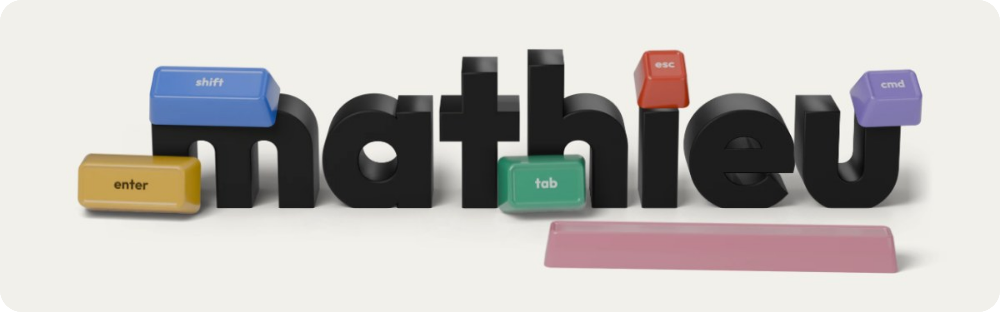
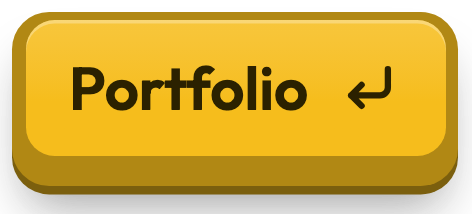
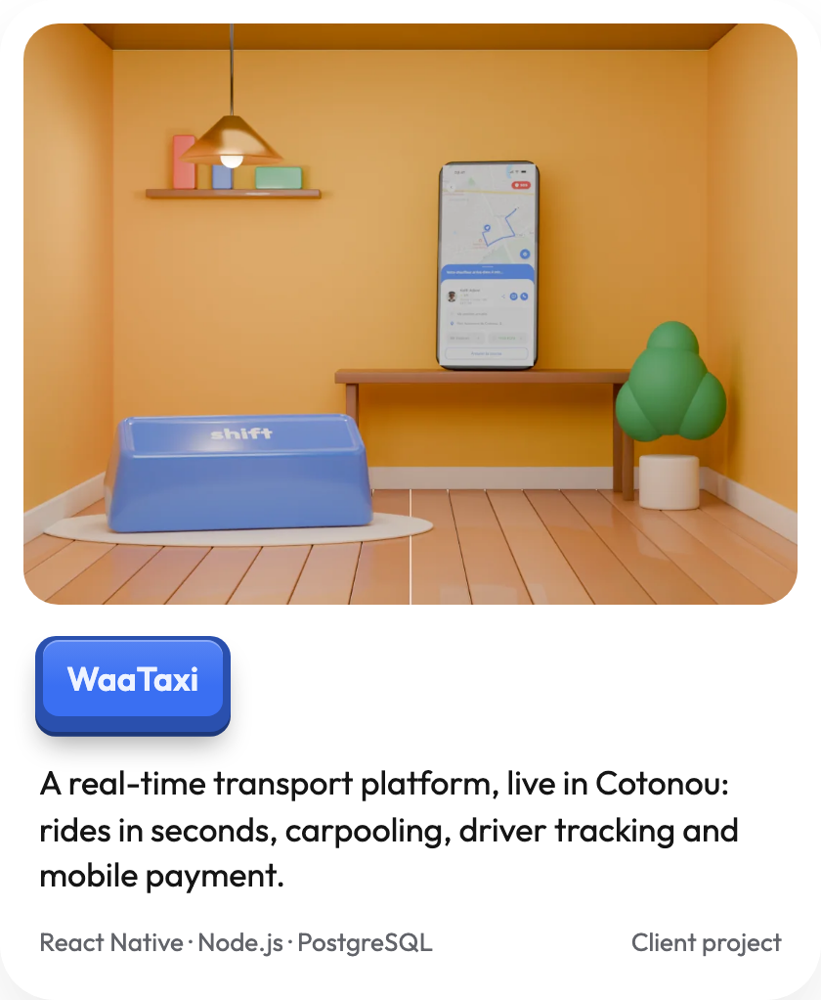
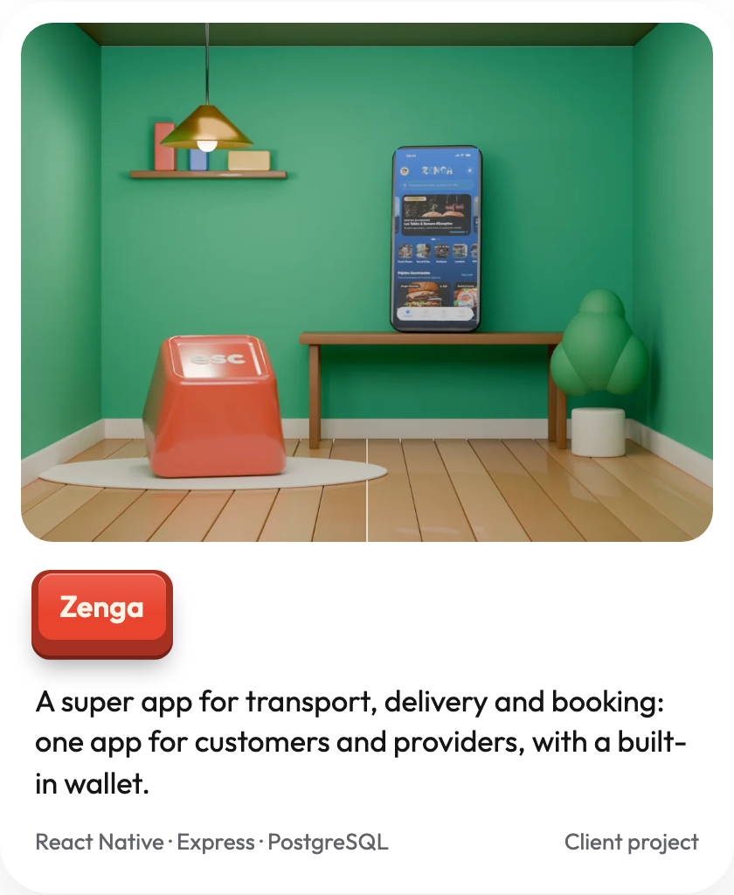
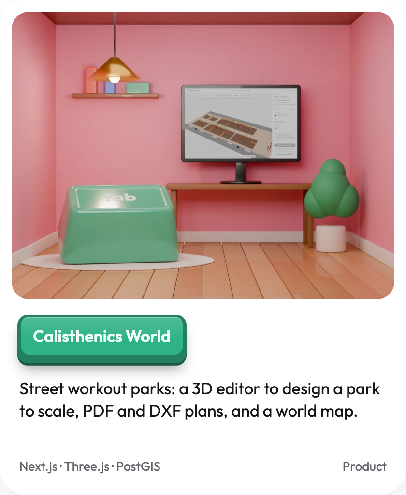
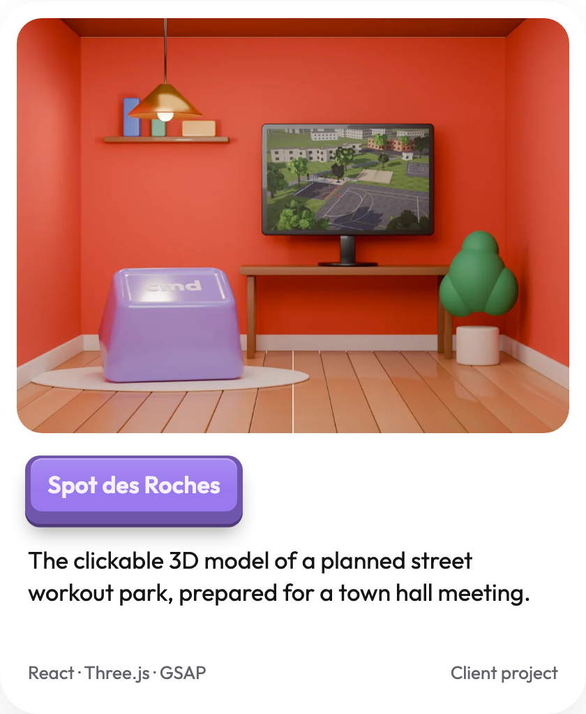
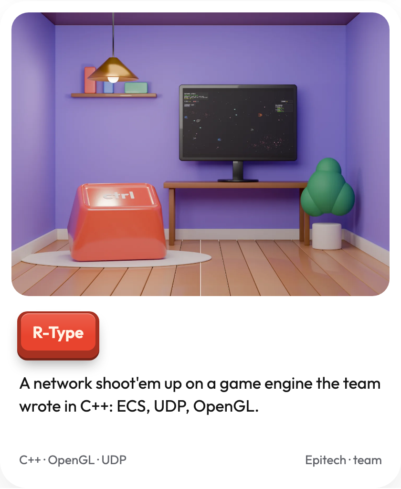
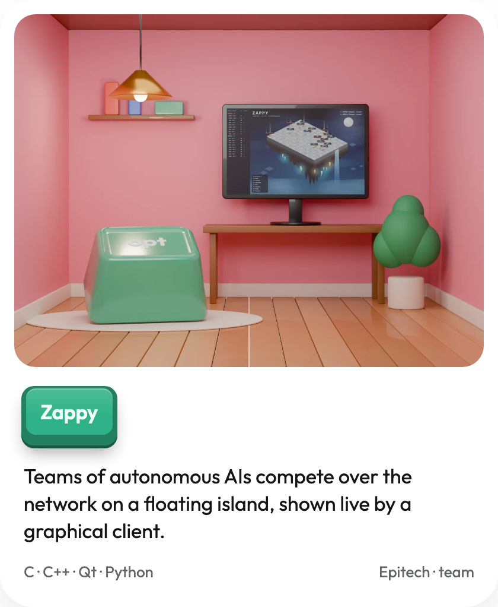
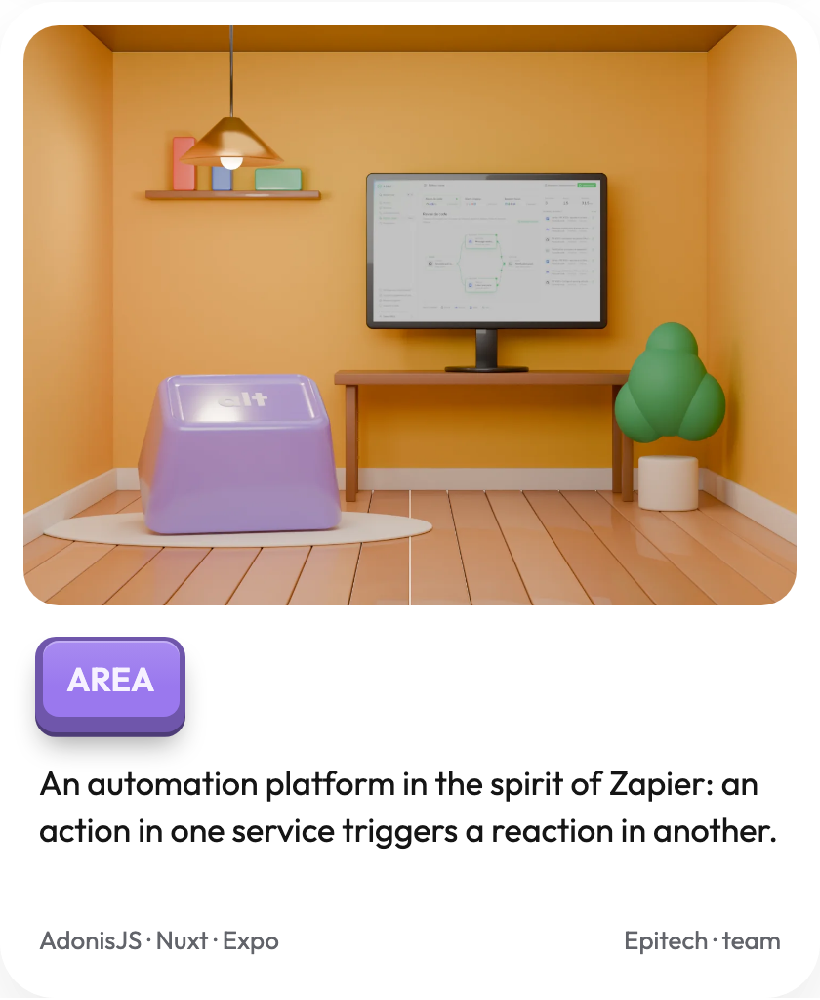
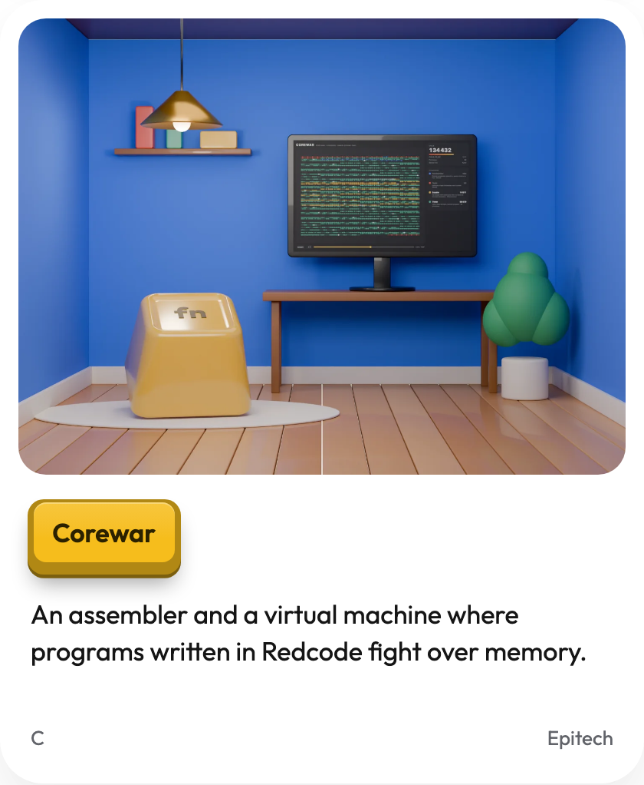

  

<h3 align="center">Freelance developer and software architect, based in Barcelona.</h3>

  I build web apps, mobile apps and SaaS, and take them all the way to production. 
  Founder of <a href="https://uplifdev.pro">Uplif Dev</a>.

  

  
  
  
  

 

## Selected work

Most client code is private. Each card opens the case study on my portfolio, with screenshots and videos.

<table>
  <tr>
    <td width="50%"></td>
    <td width="50%"></td>
  </tr>
  <tr>
    <td width="50%"></td>
    <td width="50%"></td>
  </tr>
</table>

## Team projects at Epitech

Revisited and improved in 2026.

<table>
  <tr>
    <td width="50%"></td>
    <td width="50%"></td>
  </tr>
  <tr>
    <td width="50%"></td>
    <td width="50%"></td>
  </tr>
</table>

## What I work with

TypeScript · React · Next.js · React Native · Expo · Node.js · PostgreSQL · Prisma · Three.js · Docker · C · C++ · Python · Blender

 

  

